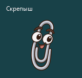

<div align="center">


# Skrepysh

**A little paperclip. A lot of personality.**

An animated paperclip companion for the Codex desktop app.
Requires a client that supports v2 pet sprite sheets (1536 × 2288 px).

[Install](#install) · [Preview](#preview) · [Files](#files) · [Contribute](CONTRIBUTING.md)

</div>

## Preview

<p align="center">
  
</p>

AI-generated artwork with nine animation states and sixteen look directions. Visual polish is paused: jagged edges may be visible at small sizes, and the preview may differ from the app.

## Install

1. Download **Code → Download ZIP** and extract it, or use an existing checkout. No build step is needed.
2. Copy the entire [`skrepysh/`](skrepysh/) folder into your pets directory:

   | Platform | Pets directory |
   | --- | --- |
   | Windows | `%USERPROFILE%\.codex\pets\` |
   | macOS / Linux | `~/.codex/pets/` |

   If you set `CODEX_HOME`, use `$CODEX_HOME/pets/` instead. App and platform support varies; the Linux path is for compatible clients.

3. Open **Settings → Pets**, select **Refresh**, and choose **Skrepysh**. Restart the app if it does not appear.
4. Enter `/pet` or select **Show pet**.

```text
pets/
└── skrepysh/
    ├── pet.json
    └── spritesheet.webp
```

See the official [Pets guide](https://learn.chatgpt.com/docs/pets) for desktop controls. Its web uploader requires **1536 × 1872 px**, so this sheet cannot be uploaded there directly. Resizing the whole sheet would change the frame layout.

## Files

| Path | Purpose |
| --- | --- |
| [`skrepysh/`](skrepysh/) | Installable package: manifest and transparent WebP sprite sheet. |
| [`spritesheet.png`](spritesheet.png) | Lossless PNG copy of the sprite sheet. |
| [`demo.gif`](demo.gif) | Animated preview. |
| [`sources/`](sources/) | Artwork references; see the [source guide](sources/README.md). |
| [`checksums.json`](checksums.json) | SHA-256 hashes of the manifest, sprite sheets, and preview. |
| [`scripts/verify.py`](scripts/verify.py) | Package integrity checker. |

### Sprite layout

| Property | Value |
| --- | --- |
| Format | v2 |
| Sheet | 1536 × 2288 px |
| Grid | 8 columns × 11 rows |
| Frame | 192 × 208 px |
| Populated animation frames | 73 |
| Animation states | 9 |
| Look directions | 16 |

## Verify

From the repository root, run:

```sh
python3 scripts/verify.py
```

On Windows, use `py -3 scripts/verify.py`. Requires Python 3, with no extra dependencies. Checks the manifest and file hashes, not rendering; also runs in GitHub Actions on pushes and pull requests.

For bug reports, include your app version, platform, and a screenshot. Artwork and documentation guidelines: [CONTRIBUTING.md](CONTRIBUTING.md).

---

An independent community pet project, not affiliated with or endorsed by OpenAI.
